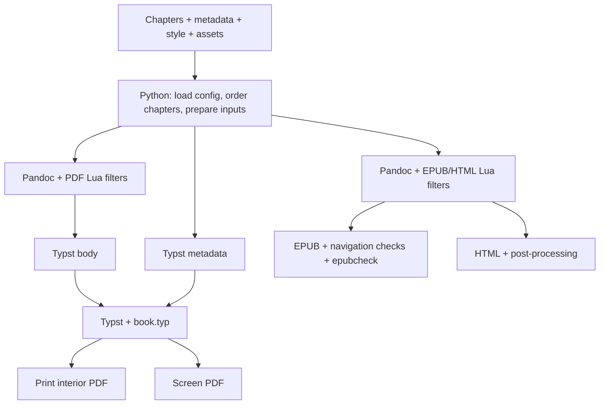

# How Book4matter fits together

Book4matter turns a folder of Markdown or plain text into a book: a print
interior PDF, a screen PDF, an EPUB, or HTML. The same manuscript feeds all four.
Pandoc handles the document structure and the reflowable formats; Typst handles
page layout for the PDFs. Python connects the pieces.

This is a map of the code for anyone changing it. Settings and instructions
belong in the [user manual](docs/chapters/005-introduction.md).

## The pipeline

The branches share book content and settings, but they don't all do the same
layout work. A PDF needs page numbers, margins, and deliberate page breaks.
An EPUB leaves pagination to the reader. That's why Typst sits on the PDF
branch instead of being the source format for everything.

## What goes in, and who owns it

Most of the orchestration lives in [bf/__main__.py](bf/__main__.py). It loads
`book_style.yaml` and `book_metadata.yaml` into one dictionary; metadata wins
when both contain the same key. The split between appearance and book identity
is a convention, not two separate configuration systems.

Chapters come from an explicit `chapters` list or from the `.md` and `.txt` files
in `chapters/`, sorted naturally by filename. Plain text is protected before
Pandoc sees it, so punctuation doesn't accidentally become Markdown. Source
files stay untouched; rewritten inputs go into temporary files and finished
books go into `out/`.

The PDF preprocessor also figures out the book's structure. Normally H1 means
a part and H2 means a chapter. Flat books can use H1 for chapters, and files
without headings can become numbered, untitled chapters. This logic lives in
`preprocess_chapters`, before Pandoc runs. EPUB and HTML have their own input
preparation, so a change to PDF heading behavior doesn't automatically carry
across to them.

## Where the formatting happens

The Lua filters in [templates/](templates/) work on Pandoc's parsed document.
They handle things ordinary Markdown doesn't express on its own: part dividers,
wrapped images, numbered items, cross-references, and indexes.

Filter order matters. On the PDF path, `tracked.lua` runs before `wrap.lua`,
which runs before `parts.lua`. References must be resolved into Typst calls
before a wrapped section becomes opaque raw Typst; page breaks must be added
after that section is packaged. EPUB and whole-book HTML use `tracked.lua`,
`epub-wrap.lua`, and `epub-parts.lua` instead. Shared Lua helpers live in
`_common.lua`.

[templates/book.typ](templates/book.typ) owns the PDF layout: page geometry,
front matter, headings, running heads, folios, contents, and page-aware
references. Python writes `_meta.typ` and Pandoc writes `_body.typ`; a small
`main.typ` joins them with the template. Both PDF outputs use this same path.
The print variant omits the cover and renders links for paper; the screen
variant keeps live links and can include a cover. Trim and margins are
configurable. Gutter defaults come from Python and an optional page-count hint;
there's no automatic compile-and-adjust loop.

EPUB and HTML use Pandoc's own writers, with `epub.css` shared between them and
`html.css` adding the browser layout. Python finishes navigation and anchor
checks, applies HTML-only additions, and runs epubcheck for EPUB validation
unless it's disabled. HTML also has separate contents-only and chapter-fragment
paths; those aren't the full-book pipeline with the outer tags removed.

Tracked items are a useful example of the division of work. The Lua filter
checks definitions and references across the book. For PDFs it emits calls that
let Typst handle numbering and page locations. For reflowable output it supplies
the numbers and links itself, because there are no fixed pages to refer to.

## Files, tools, and the edges of the system

[run.sh](run.sh) is the host-side Docker wrapper. The image contains Python,
Pandoc, Typst, fonts, templates, and the validation tools. Normal builds mount
the source tree read-only and make the target book's `out/` writable. Import and
imposition have different write boundaries because they produce different
files. `bf all` simply runs the four output builds in sequence.

Asset paths are part of the contract. PDF intermediates live in `out/`, with
Typst's root set to the book directory; `../media/image.png` therefore reaches
the book's `media/` directory. EPUB and HTML use Pandoc resource paths covering
`chapters/` and the book root. Moving intermediate files or changing staging
needs care here. PDF builds also expose a book's `fonts/` directory to Typst;
EPUB uses reader-selected fonts rather than embedding those files.

Word import is a separate preparation step: Pandoc extracts Markdown and media,
then Python splits the manuscript into chapter files. PDF imposition is a
separate finishing step: `_signature_sides` computes page order and `impose_pdf`
uses pypdf to scale and merge pages, then compresses the resulting streams.
Neither operation belongs inside the typesetting template. Printing and binding
guidance lives in the [manual's impose section](docs/chapters/110-command-line.md#impose).

## book4matter-web

[book4matter-web](https://github.com/cocode/book4matter-web) is the browser app
in a separate repository. Conversion happens on the user's device in a web
worker. It runs the Python engine through Pyodide and uses WebAssembly builds
of Pandoc and Typst, with an adapter translating the engine's tool calls into
browser operations. There's no conversion server behind it.

The web build copies this repository's `bf/` and `templates/` from a selected
publishing revision. That keeps much of the formatting shared, but the web app
owns upload handling, its virtual filesystem, runtime integration, and downloads.
It also has different constraints: for example, it doesn't run Java epubcheck.
Changes to tool arguments, file paths, or generated files can affect the browser
adapter as well as the CLI, so check that integration when changing those
boundaries. The `web/` folder here is the source for the Book4matter website,
not the browser app.

## Finding the right place to make a change

Start with Python for input handling, configuration, and build orchestration;
Lua for document structure; Typst for PDF layout; and CSS for EPUB/HTML
appearance. A new setting usually needs Python to pass it through as well as a
template or filter to consume it. Templates are copied into the Docker image,
so an existing image can contain older code than the working tree.

The Python tests under `tests/test_*.py` cover preprocessing, tracked items, and
index behavior. The fixture books and `tests/run.sh` exercise generated EPUB,
HTML, and selected PDF behavior, including imposition. `example/`, `novel/`,
`docs/`, and `web/` are also real book projects. Pick the outputs affected by a
change, and look at the rendered result when changing layout: a successful
compile won't tell you whether a chapter opener looks right.
